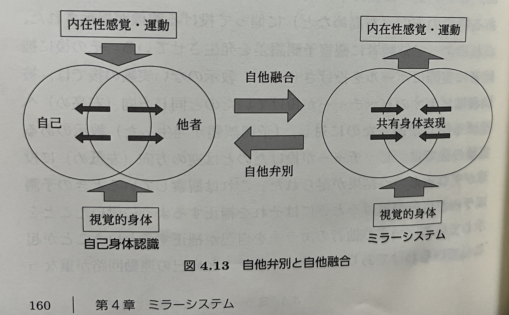

# ヒトの自他融合-自他弁別システムとGANとの類似性について
#### (Human-Robot or Robot-Robot Interactionに向けて)
---

## ヒト脳の自他融合（ミラー）システムと自他弁別システム

- **ヒトの自他融合システム**: 他者の表情や行動(や意図)を観察し、模倣するためのシステム。
- **ヒトの自他弁別**: 自己と他者を区別し、適切な行動を取るシステム。
[*1 "脳のなかの自己と他者" より]
---

## GANとの類似性

- **ジェネレータ (Generator)**
  - 自他融合（ミラー）システムに対応
  - 他者の行動を効率的に学習して（過去や）未来を生成

- **ディスクリミネータ (Discriminator)**
  - 自他弁別システムに対応
  - 自分と他者の区別を行う

---

## 実装方法: ミラーシステム

- **入力データ:** シミュレーションや動画などから他者の行動データを取得
- **模倣行動生成:** 観察データを基に新たな行動を生成
- **学習プロセス:** 模倣精度を向上させるための学習

---

## 実装方法: 自他弁別システム

- **センサーデータ処理:** 自己と外部のデータを比較
- **判別アルゴリズム:** 自己と他者をマッチングにより区別するアルゴリズムを使用
- **フィードバックループ:** 判別結果に基づき行動調整

---

## 実装後のメリット

1. **過去や未来の生成時に条件付けが自か他か明示的にできる**
2. **人間や他のロボットとの協働作業や社会的相互作用の効率化**
3. **自己認識の向上**
4. **共感的行動の実現？**

---

## まとめ
- ミラーシステムと自他弁別システムの実装は、ロボットが人間と自然に協働し、自己認識や共感的行動を高める鍵となる。
- GANの構造を応用することで、これらのシステムの開発が可能になる。(注1)

## 参考
- *1 脳のなかの自己と他者 
  - https://www.kyoritsu-pub.co.jp/book/b10003203.html
- 注1 GANの学習の弱点はSANに変更することで解決される。
  - https://ytakida.github.io/san/